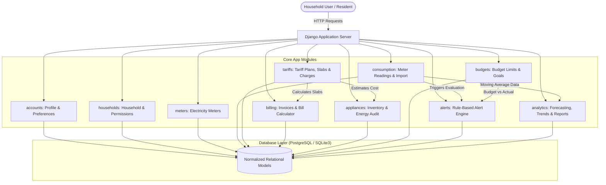
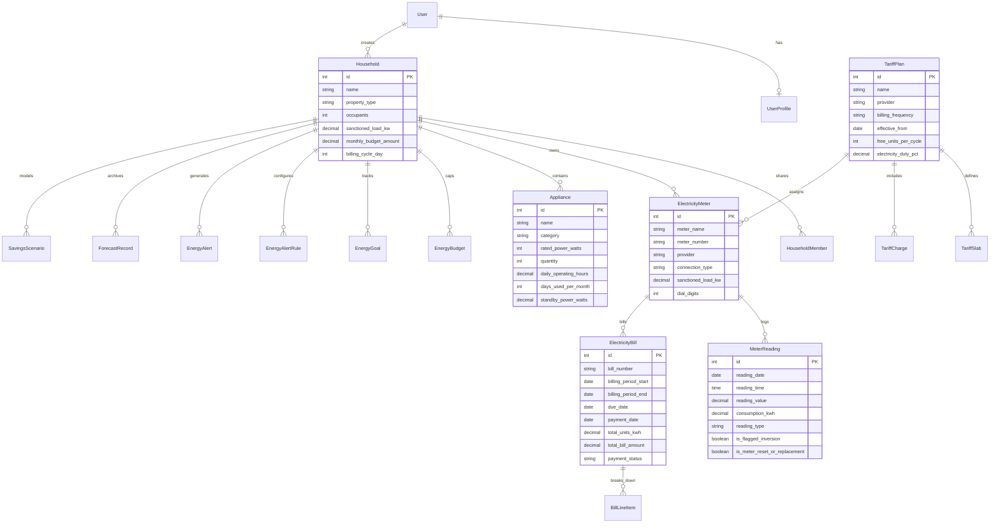

# AmpereNest — System Architecture & Data Model

## 1. High-Level Architectural Flow

## 2. Database Entity-Relationship (ER) Model

## 3. Key Architectural Principles
- **Idempotent Cumulative Meter Calculation**: On every cumulative reading entry, the system looks up the chronological predecessor and re-evaluates the successor reading to prevent data cascading drift.
- **Telescopic Slab Calculation Algorithm**: Progressively tiers consumed units across slabs with support for government subsidies (e.g. Tamil Nadu 100 free units) and duty percentages.
- **Data Isolation**: All view queries strictly filter against `accessible_households` populated by `HouseholdContextMiddleware`.
